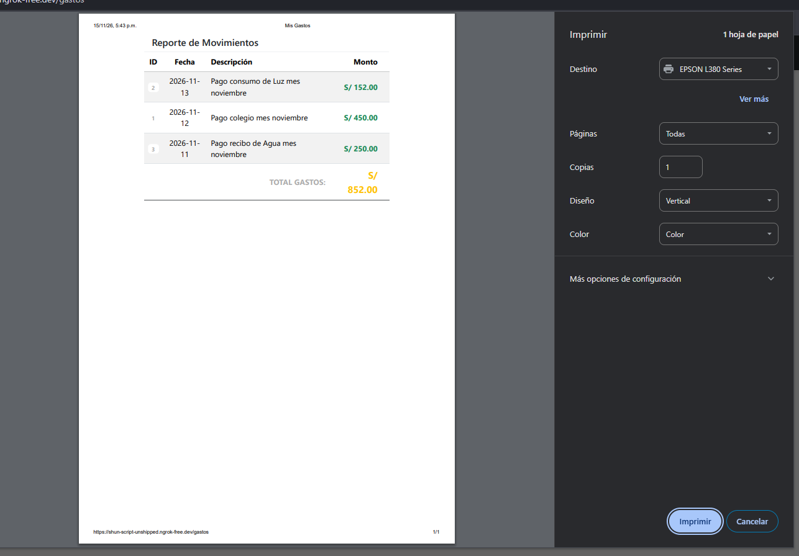

Markdown
## 📸 Capturas del Sistema y Funcionamiento

### 1. Pantalla de Acceso (Login)

**¿Cómo funciona?**
La interfaz de seguridad está construida con Bootstrap 5. El usuario ingresa al sistema validando sus credenciales (admin / 123) mediante una petición web tipo **POST**. El backend en Flask recibe estos datos, los valida, y si son correctos, crea una **sesión segura** que habilita el acceso al panel principal.

### 2. Panel Principal (Registro y Reporte)

**¿Cómo funciona?**
Esta pantalla está protegida por la sesión de usuario y se divide en dos procesos principales:
* **Registro de Gastos (Formulario izquierdo):** Permite ingresar la fecha, descripción y monto. Al presionar el botón, Flask captura los datos y ejecuta una sentencia SQL `INSERT` para almacenarlos permanentemente en la base de datos **SQLite**.
* **Visualización y Reporte (Tabla derecha):** Al cargar la página (petición **GET**), el sistema hace una consulta SQL `SELECT` para extraer el historial completo. Utiliza el motor de plantillas **Jinja2** para dibujar cada fila de la tabla de forma dinámica e incluye un cálculo en Python para mostrar la **sumatoria total** de los montos en la parte inferior.
