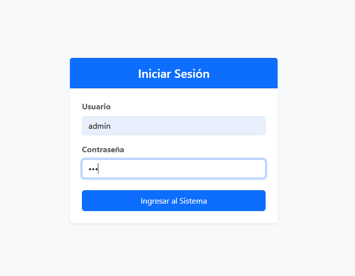
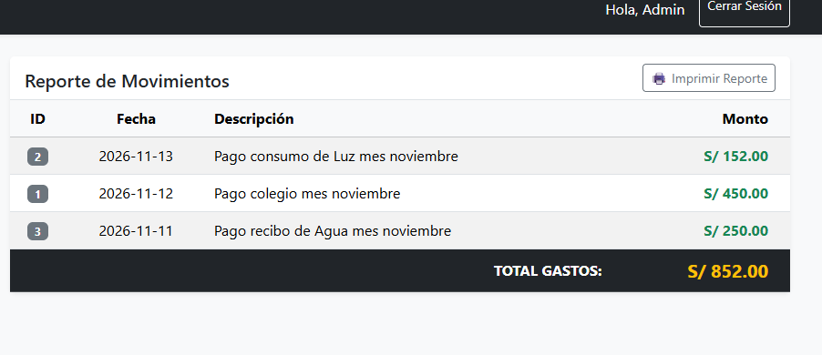

Markdown
## 📸 Capturas del Sistema y Explicación Técnica

### 1. Pantalla de Acceso (Login)

**Funcionamiento del Login:**
El sistema inicia con una interfaz de seguridad diseñada con Bootstrap 5. El usuario ingresa sus credenciales y, al enviar el formulario, los datos se transmiten al backend en Flask mediante el método **POST**. El servidor valida estáticamente el usuario "admin" y la contraseña "123". Si la validación es exitosa, se genera una **sesión encriptada** que autoriza el acceso a las rutas protegidas del sistema.

### 2. Módulo de Registro de Gastos

**Funcionamiento del Registro (Backend):**
Esta sección está dedicada al ingreso de datos. El usuario completa la fecha, la descripción del gasto y el monto decimal. Al hacer clic en guardar, Flask captura esta información a través de una petición **POST**. Internamente, el sistema abre una conexión con la base de datos **SQLite**, ejecuta una sentencia `INSERT INTO gastos` para almacenar la información de forma persistente, y realiza un commit para confirmar los cambios.

### 3. Visualización y Reporte de Movimientos

**Funcionamiento de la Visualización (Frontend y Lógica):**
Al cargar la ruta principal del panel (mediante una petición **GET**), Flask ejecuta una consulta `SELECT * FROM gastos` ordenando los registros por fecha. 
* **Generación dinámica:** Se utiliza el motor de plantillas **Jinja2** para iterar sobre los datos y dibujar cada fila de la tabla HTML automáticamente.
* **Cálculo integrado:** Antes de enviar los datos a la vista, Python procesa la lista de gastos y calcula la sumatoria total, la cual se inyecta en el pie de la tabla.
* **Exportación:** Se incluye un botón de impresión impulsado por JavaScript (`window.print()`) con reglas CSS específicas (`@media print`) que ocultan el menú y el formulario para generar un documento limpio en formato PDF o papel.
